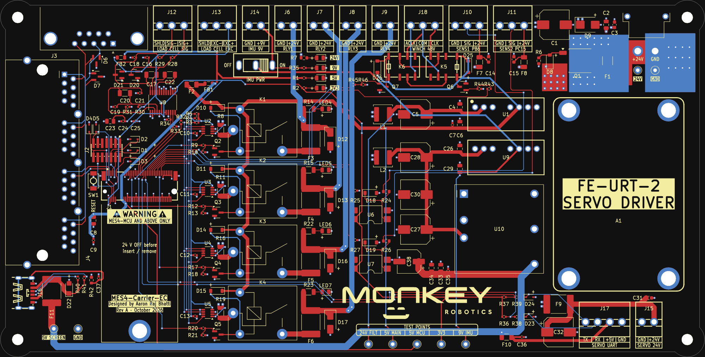

# MES4-Carrier-EC

Production carrier board for one [MES4-MCU](https://github.com/aaronraj11/MES4-MCU) M.2 module (STM32G0B1) on the **E-Crawler** robot. It drives four 24 V relay outputs and the winch direction relays, reads two Autonics sensors and a load cell, talks CAN, and powers the IMU, the screen and the door servo.

Monkey Robotics · Rev A · KiCad 9 · Designed by Aaron Raj Bhatti

  

> **Work in progress.** Read [`HANDOFF.md`](MES4_Carrier_EC/HANDOFF.md) before changing anything. Full board description: [`MES4_Carrier_EC/README.md`](MES4_Carrier_EC/README.md).

## Repository contents

Everything is in [`MES4_Carrier_EC/`](MES4_Carrier_EC):

| Path | |
|---|---|
| `MES4_Carrier_EC.kicad_pro` / `.kicad_sch` / `.kicad_pcb` | KiCad 9 project: 11 schematic sheets and the routed PCB |
| `MES4_Carrier_EC.pdf` | schematic as PDF |
| `generator/` | Python that generates the schematic, plus PCB helper scripts (DRC, DFM, CPL check, renders) and the enclosure generator |
| `production/` | JLCPCB files: gerber zip, BOM, CPL, IPC netlist |
| `sim/` | LTspice benches and `report.pdf` |
| `review/` | design review packages (R2, R3), 1:1 print PDF, board STEP and layout screenshots |
| `enclosure/` | base and lid STEP / STL with a preview |
| `MES4-Carrier-EC.pretty`, `.3dshapes`, `.kicad_sym` | project footprints, 3D models and symbols |
